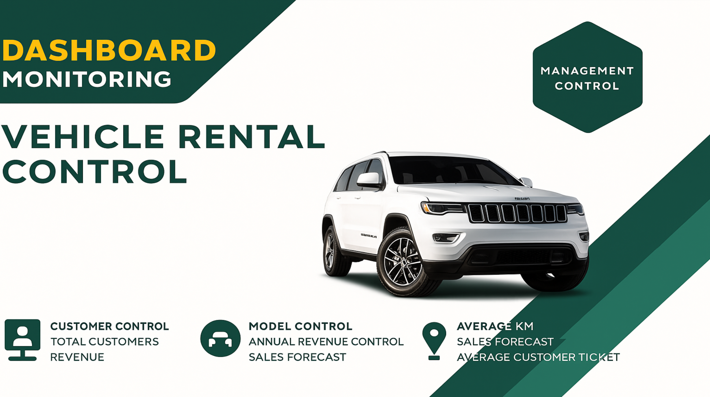
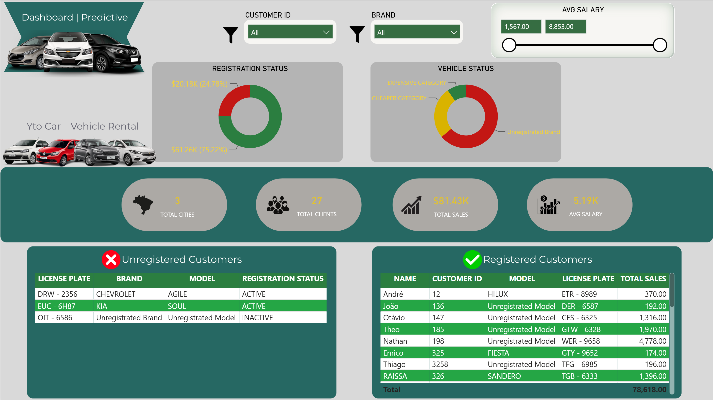
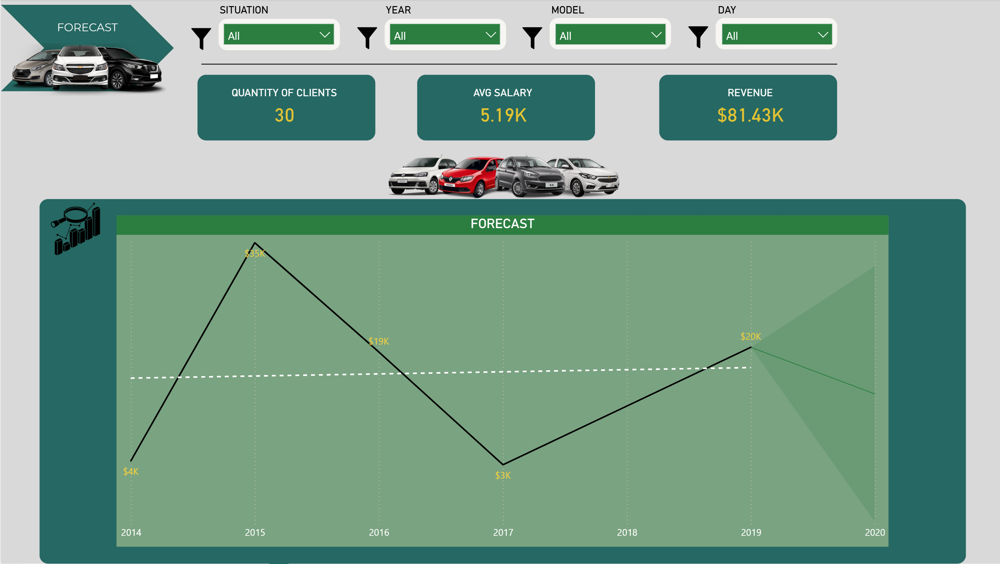
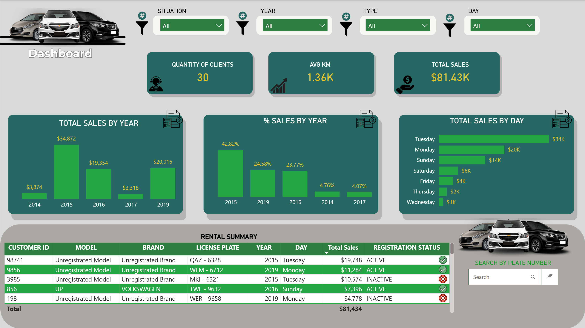

# Vehicle Rental Management Dashboard | Power BI

## Project Overview

This project presents an interactive Power BI dashboard designed to monitor vehicle rental operations, customer information, sales performance, and historical revenue trends.

The dashboard transforms operational data into visual reports, helping users explore key performance indicators (KPIs), identify patterns, and support data-driven business decisions.

## Business Objectives

The main objectives of this project are to:

- Monitor total sales and customer activity.
- Analyse revenue performance across different years and days.
- Explore customer and vehicle registration status.
- Monitor vehicle brands, models, and operational metrics.
- Visualise historical trends and explore revenue forecasts.
- Provide interactive reports to support operational decision-making.

## Tools & Technologies

- **Power BI:** Interactive dashboards, data visualisation, and KPI reporting.
- **Power Query:** Data preparation and transformation.
- **Microsoft Excel:** Data organisation and analysis.
- **DAX:** KPI measures and calculations (subject to verification in the original Power BI file).

## Dashboard Pages

### 1. Project Overview

The cover page introduces the Vehicle Rental Management Dashboard and highlights its key monitoring areas, including customer control, vehicle information, and revenue analysis.

### 2. Customer & Vehicle Monitoring

This page provides an operational overview of customers and vehicles.

**Key features:**
- Customer and vehicle status distribution.
- Total cities and customers.
- Total sales and average metrics.
- Registered and unregistered customer records.
- Interactive filtering by customer ID, vehicle brand, and value range.

### 3. Revenue Trends & Forecast

This page provides a visual overview of historical sales performance and a forecasting view.

**Key features:**
- Total customers and revenue KPIs.
- Historical sales trends.
- Interactive filtering by year, model, situation, and day.
- Forecast visualisation for business planning.

### 4. Sales Performance Analysis

This page presents detailed sales performance metrics and rental transaction records.

**Key features:**
- Total sales by year.
- Percentage contribution to total sales by year.
- Sales distribution by day of the week.
- Customer and vehicle transaction details.
- Interactive filtering and licence plate search.

## Key Findings

Based on the displayed dashboard results:

| Metric | Result |
|---|---|
| Total Sales | $81.43K |
| Total Customers | 30 |
| Highest Sales Year | 2015 — approximately $34.87K |
| Highest Sales Day | Tuesday — approximately $34K |
| Average KM | 1.36K |

### Business Observations

- **Sales concentration:** 2015 represents the highest annual sales value displayed in the dashboard.
- **Weekly performance:** Tuesday accounts for the highest displayed sales total by day of the week.
- **Customer monitoring:** Registration status can be explored to identify records requiring review.
- **Operational visibility:** Interactive filters allow users to investigate performance across vehicle categories and reporting periods.

*Note: These findings are based on the dashboard screenshots and have not been independently validated against the underlying dataset.*

## Skills Demonstrated

- Business Intelligence reporting.
- Power BI dashboard development.
- KPI monitoring and data visualisation.
- Data preparation and transformation.
- Interactive filtering and exploratory analysis.
- Sales and operational performance reporting.
- Communication of business information through dashboards.

## Potential Improvements

Future enhancements to this project include:

- Documenting data validation and cleaning procedures.
- Reviewing KPI definitions and naming conventions.
- Improving dashboard accessibility and visual consistency.
- Validating forecast assumptions and calculations.
- Expanding technical documentation of the data model.

## Author

**Larissa Krumel**

Sydney, Australia

[GitHub Profile](https://github.com/larissakrumel)

---

*Portfolio project demonstrating practical Power BI and business reporting skills.*
